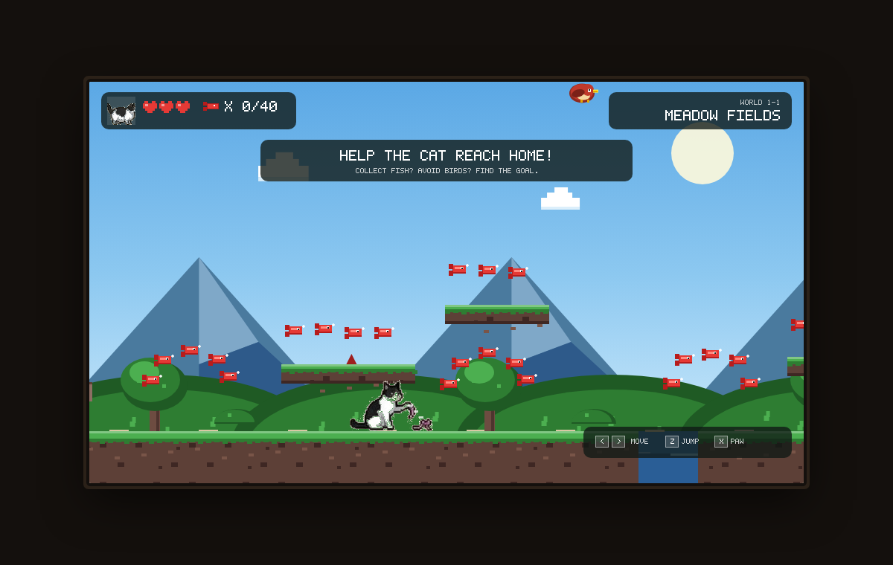

# CAT HERO — sandbox

> Prototype build. Add `?dev=1` for hitboxes, time scale, spawn and teleport.
> Tools and workflow: `SANDBOX.md`. Stable build lives in `../cat-hero-restyle`.

# CAT HERO — restyle fork

> Design pass on top of `../cat-hero`: paper-card screens, a warm single-source palette,
> and the control legend moved out of the play band. Spec and rationale: `DESIGN.md`.
> Live: https://j00bi.github.io/cat-hero-restyle/
> Gates: `tools/design.mjs`, `tools/palette_check.py`, plus the five gameplay suites.

A small pixel platformer built around the **CAT HERO** sprite sheet. Seven rooms, one cat,
one cushion to get home to — currently inside a giant robot vacuum. No dependencies, no build step — plain Canvas 2D.



## Play

**Public:** https://j00bi.github.io/cat-hero/ — share this link, works on phones.

Locally:

```bash
cd ~/projects/cat-hero
python3 serve.py          # http://127.0.0.1:8891
```

Publish an update (builds the itch zip and pushes to Pages):

```bash
tools/publish.sh          # -> https://j00bi.github.io/cat-hero/
```

`file://` will not work — the game fetches `assets/cat-atlas.json`.

## Controls

| Action | Keys |
|---|---|
| Move | `←` `→` (or `A` `D`) |
| Jump | `Space` / `Z` / `↑` / `W` — hold for height |
| Paw swipe | `X` / `J` |
| Pause | `P` / `Esc` |
| Mute | `M` |

On a phone: **tap the screen to start**, then use the on-screen pad.

Touch controls appear automatically on phones and tablets.

### Ray rooms (Dust Bin, The Motor)

The two first-person stages use the same keys, read differently:

| Action | Keys | Touch |
|---|---|---|
| Turn | `←` `→` / `A` `D` | ◀ ▶ |
| Forward | `↑` / `W` / `Space` / `Z` | JUMP (hold) |
| Back | `↓` / `S` / `J` / `X` | PAW (hold) |
| Charge | hold `Shift` / `C`, release to cast | ⚡ |

Charge only fills while you stand still (turning is fine). The dust bin is dark —
charging widens the light. Reach the door to clear it; in The Motor, fill the meter
while facing the core and release.

## Rules

- 3 lives. Falling into a gap costs one and respawns you at the room entrance.
- Robot vacuums patrol every room. **Stomp** them from above, or **swipe** them with the paw.
- Fish coins are score. The cushion (or the open door in a ray room) is the exit.
- Five demo stages: **Backyard**, **The Climb**, **Dust Bin**, **The Motor**, and
  **The Den** — the boss arena. Dust Bin and The Motor are real first-person raycaster
  rooms (`ray: true`): find the exit door in the dark bin, overload the motor core.
  `tools/ray.mjs` covers both. The four old 1-x rooms live in `LEVELS_EXTRA` for the
  post-jam extended mode.
- **Moving platforms.** Dock planks drift sideways, mill lifts rise and fall. Stand on one
  and it carries you — no input needed. They are the only way to reach some of the high
  fish lines, and the floor is never the whole route.

## The Dust King

Room 1-7 is a one-screen arena. The Dust King is a roomba that swallowed the cushion, so
the exit does not exist until it is dead.

- It patrols toward you, then **telegraphs** (trembles, revs) and **charges**.
- You cannot hurt it while it is moving — stomping the shell just bounces you off.
- Bait the charge into an arena wall. The impact **stuns** it for 2.5 s, the stars come out,
  and *now* a stomp lands. Three stuns win.
- Every hit you take costs a life and **restarts the fight** at full boss health. Three lives,
  three attempts — no grinding, no half-dead boss.

When it dies the cushion pops out and the room becomes completable.

## How the art got here

The source is a JPEG sprite sheet with a flat beige background, black outlines and
two cats. `tools/extract_atlas.py` turns it into a usable atlas:

1. Estimate the background from the border ring, build an ink mask by colour distance.
2. Label connected components, then group them into rows by vertical centre.
3. Rebuild each frame from the **body blob plus any nearby blob** — thin tails and
   detached paws survive JPEG as separate components and would otherwise be cut off.
4. Bottom-centre each frame in a per-row cell, with a soft alpha key so no beige halo remains.
5. Measure a **foot line** per frame (lowest row with a paw-sized run of ink) so a hanging
   tail never becomes the ground contact point.

Output: `assets/cat-atlas.png` + `assets/cat-atlas.json`
(`{variant: {animation: [{x,y,w,h,foot}]}}`), plus `assets/contact.png` for eyeballing.

## Verification

Not eyeballed — measured. All three scripts run against a live Chromium.

```bash
node tools/design.mjs      # HUD never enters the play band
python3 tools/palette_check.py  # card/panel contrast + band sampling
node tools/test.mjs        # 14 gameplay assertions
node tools/platforms.mjs   # planks travel + carry the cat
node tools/boss.mjs        # bait, stun, stomp x3, cushion returns
node tools/reach.mjs       # every platform reachable from spawn
node tools/playthrough.mjs # autopilot finishes every 2D stage (ray rooms excluded)
node tools/ray.mjs         # Dust Bin door + charge, Motor blast, phone JUMP, fps
node tools/mobile.mjs      # iPhone: tap-to-start, touch pad, hero switch
node tools/story.mjs       # opening cards -> 5-stage flow -> ending card -> win
node tools/phase11.mjs     # Shift guard, blur cancel, failed-release fizzle
```

- `test.mjs` — boots the game, plays it with real key events: menu → hero select → room,
  walks, jumps (measures a 105 px apex), swipes, stomps a robot, collects fish, clears the
  room, loads room 2, falls in a pit and confirms the life loss. Fails on any console error.
- `platforms.mjs` — samples plank motion, drops the cat on a moving plank and on a vertical
  lift, and asserts it is carried (last run: 32 px carried for 32 px of plank travel).
- `boss.mjs` — loads The Den, confirms the cushion is hidden, proves stomping an un-stunned
  boss does nothing, then baits three wall-slams and stomps each stun to zero health. Also
  checks that dying resets the boss to full and costs exactly one life.
- `reach.mjs` — BFS over standable surfaces using the jump envelope (190 px across,
  112 px up), including moving-platform travel as standable ground. Catches decorative
  ledges that can never be reached.
- `playthrough.mjs` — an in-page autopilot holds right, jumps at gaps and walls, swipes at
  robots, and must reach the cushion in every 2D room. It also asserts the demo still has
  five non-sandbox stages, two of them ray rooms. The first-person rooms are excluded —
  a 2D bot cannot solve them; `ray.mjs` drives those directly.
- `ray.mjs` — loads DUST BIN on the `S` tile, opens the exit door and walks through it,
  charges to 100 and screenshots the lit room, measures fps while charging, then overloads
  THE MOTOR core and checks the blast advances to the boss. A phone viewport proves a held
  JUMP button moves the cat. Fails on any console/page error.

Playwright is loaded from the Hermes node tree:

```js
import { chromium } from "/home/husni/.hermes/node/lib/node_modules/playwright/index.mjs";
```

## Layout

```
index.html          canvas + touch buttons
style.css           page chrome
game.js             everything else (~1100 lines, no deps)
assets/             extracted atlas, JSON, contact sheet
tools/extract_atlas.py  sprite sheet -> atlas
tools/platforms.mjs     moving-platform proof
tools/boss.mjs          Dust King fight proof
tools/ray.mjs           first-person room proof
tools/*.mjs         tests (start a server on :8920, or set BASE)
shots/              screenshots produced by the tests
```

## Tuning

Physics lives at the top of `game.js`: `GRAV 2200`, `JUMP_V -690` (≈108 px apex),
`MOVE 272`, plus coyote time and a jump buffer. Rooms are plain data — `rect()`, `arc()`
and `line()` helpers build `solids`, `coins` and `enemies`; add a room to `LEVELS` and it
is playable immediately.

Moving platforms are a `platforms` array per room:

```js
{ x: 600, y: 300, w: 140, h: 18, axis: "x", range: 110, speed: 0.8, phase: 0 }
```

`axis` is `"x"` (drift) or `"y"` (lift), `range` is the half-travel in pixels, `speed` is
radians/sec and `phase` offsets the cycle. The position is
`origin ± sin(t * speed + phase) * range`, so a plank is always somewhere on its path —
levels stay deterministic and the reach checker can treat the sweep as standable ground.
